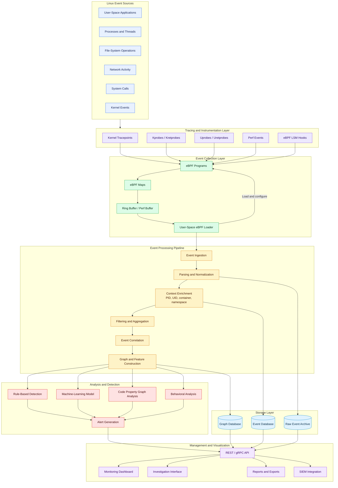
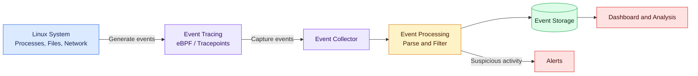

<div align="center">
    <p align="center">
        <a align="center" href="https://docs.kernel.org/trace/events.html">
          
        </a>
    </p>



# **`LET`** | _Event Tracing for Linux_
> LET is a tracing facility that allows a user to log events to a file (_JSON, XML, CSV_)
</div>

[]()
[]()
[]()

<p align="center">
    <a href="https://github.com/cybersecurity-dev/"></a>
    &nbsp;
    <a href="https://www.youtube.com/@CyberThreatDefence"></a>
    &nbsp;
    <a href="https://cyberthreatdefence.com/my_awesome_lists"></a>
    
</p>

[](https://github.com/cybersecurity-dev/LET)



## 📖 Contents
- [Installation Steps](#installation-steps)
- [My Awesome Lists](#my-awesome-lists)
- [Contributing](#contributing)
- [Contributors](#contributors)

## Installation Steps

<details>

<summary>Install required tools on Linux</summary>

### For Ubuntu 18.04, 20.04, 22.04

```bash
sudo apt-get update
sudo apt-get install -y libtraceevent-dev \
                        libtracefs-dev
```
</details>

<details>

<summary>Install required python libs</summary>

### pip install
```bash
pip install -r requirements.txt
python3 setup.py install
```

### conda install
```bash
conda config --add channels conda-forge
conda install --file requirements_conda.txt
python3 setup.py install
```

</details>

## Common Linux Kernel Event Types

| **Event Type**       | **Description**                                                             | **Subsystem / Use Case**           |
|----------------------|------------------------------------------------------------------------------|------------------------------------|
| `IN_ACCESS`          | File was accessed                                                           | inotify                            |
| `IN_MODIFY`          | File was modified                                                           | inotify                            |
| `IN_ATTRIB`          | Metadata changed (e.g., permissions, timestamps)                            | inotify                            |
| `IN_CLOSE_WRITE`     | File opened for writing was closed                                          | inotify                            |
| `IN_CLOSE_NOWRITE`   | File not opened for writing was closed                                      | inotify                            |
| `IN_OPEN`            | File was opened                                                             | inotify                            |
| `IN_MOVED_FROM`      | File moved out of watched directory                                         | inotify                            |
| `IN_MOVED_TO`        | File moved into watched directory                                           | inotify                            |
| `IN_CREATE`          | File/directory created in watched directory                                 | inotify                            |
| `IN_DELETE`          | File/directory deleted in watched directory                                 | inotify                            |
| `IN_DELETE_SELF`     | Watched file/directory was itself deleted                                   | inotify                            |
| `IN_MOVE_SELF`       | Watched file/directory was itself moved                                     | inotify                            |
| `EPOLLIN`            | File descriptor is ready for read                                           | epoll                              |
| `EPOLLOUT`           | File descriptor is ready for write                                          | epoll                              |
| `EPOLLERR`           | Error condition on file descriptor                                          | epoll                              |
| `EPOLLHUP`           | Hang up happened on the associated file descriptor                          | epoll                              |
| `FAN_ACCESS`         | File was accessed                                                           | fanotify                           |
| `FAN_MODIFY`         | File was modified                                                           | fanotify                           |
| `FAN_CLOSE_WRITE`    | Writable file was closed                                                    | fanotify                           |
| `FAN_CLOSE_NOWRITE`  | Unwritable file was closed                                                  | fanotify                           |
| `FAN_OPEN`           | File was opened                                                             | fanotify                           |
| `FAN_EVENT_ON_CHILD` | Events occurred on a child of the watched directory                         | fanotify                           |
| `KEY_PRESS`          | Key was pressed                                                             | input subsystem (`/dev/input`)     |
| `KEY_RELEASE`        | Key was released                                                            | input subsystem (`/dev/input`)     |
| `REL_X`, `REL_Y`     | Relative mouse movement                                                     | input subsystem                    |
| `ABS_X`, `ABS_Y`     | Absolute pointer position                                                   | input subsystem                    |
| `AUDIT_SYSCALL`      | System call event                                                           | auditd / kernel audit subsystem    |
| `NETLINK_ROUTE`      | Network interface changes (e.g., link up/down)                              | netlink                            |


##

### My Awesome Lists
You can access the my awesome lists [here](https://cyberthreatdefence.com/my_awesome_lists)

### Contributing

[Contributions of any kind welcome, just follow the guidelines](contributing.md)!

### Contributors

[Thanks goes to these contributors](https://github.com/cybersecurity-dev/LET/graphs/contributors)!

[🔼 Back to top](#let--event-tracing-for-linux)
